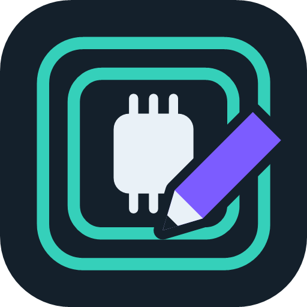
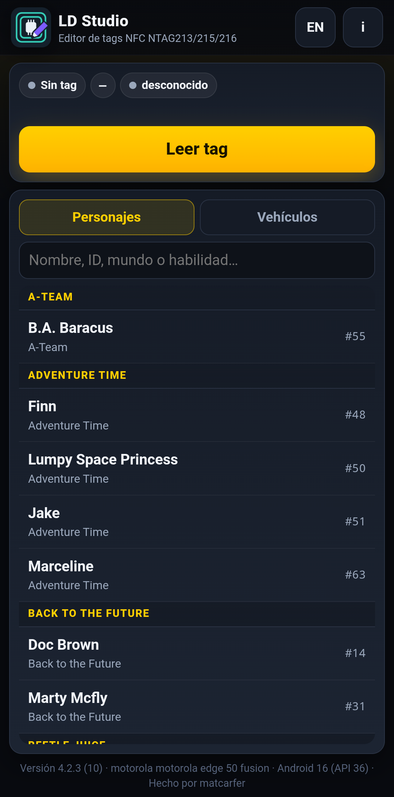
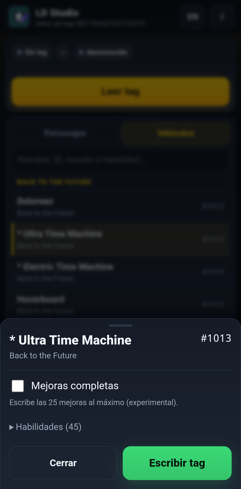

<h1 align="center">LD Studio</h1>

<h2 align="center"><a href="https://github.com/matcarfer/LDStudio/releases/download/v4.2.4/LDStudio-4.2.4.apk">⬇ Download APK</a></h2>

  <a href="README.md">Español</a> · <b>English</b>  
Read and write NTAG213, 215 and 216 NFC tags compatible with LEGO Dimensions. 
No internet, no ads and no accounts. 
<b>Compatible with Android 5 to 17.</b>

  
  

**How to use:** tap Read tag, pick a character or vehicle, hold a blank NTAG213, 215 or 216 tag you own against the phone and confirm.

**Never writes originals:** it detects them and treats them as read-only.

  <a href="https://github.com/matcarfer/biblioteca-gaming/blob/main/README.en.md">📚 Gaming library</a>

---

<b>This project is free and neither requests nor accepts contributions or donations.</b> Free, closed source, unofficial. Do not redistribute: share this link. No warranty and no author liability, to the maximum extent permitted by law: use it at your own risk, only with tags you own and according to the law of your country. Writing tested on NTAG213; NTAG215, 216 and the game not tested. "LEGO" and "LEGO Dimensions" are trademarks of The LEGO Group, which is not affiliated with and does not endorse this project. <a href="LICENSE.en">License</a> · <a href="PRIVACY.md">Privacy</a> · <a href="NOTICE.md">Third-party notices</a> · <a href="https://www.virustotal.com/gui/file/96c4e4e0889aa538f418fb8e1a7582d09f460d9914990b6e6ac54b2277ee4138">VirusTotal</a>
