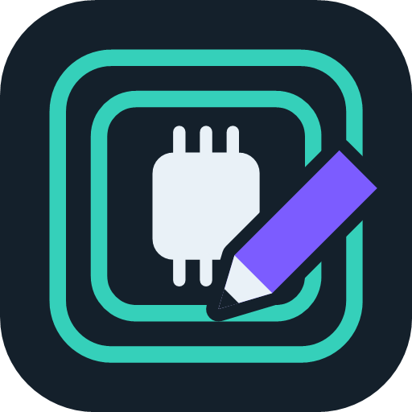
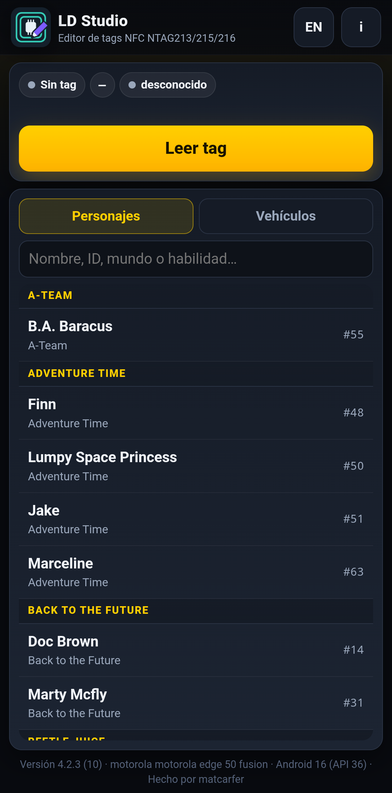
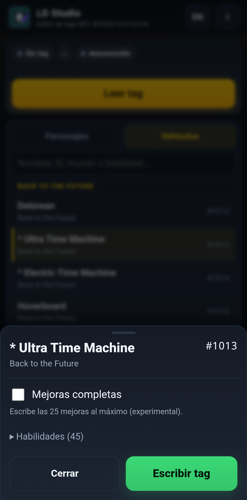

<h1 align="center">LD Studio</h1>

<h2 align="center"><a href="https://github.com/matcarfer/LDStudio/releases/download/v4.2.4/LDStudio-4.2.4.apk">⬇ Descargar APK</a></h2>

  <b>Español</b> · <a href="README.en.md">English</a>  
Leé y escribí tags NFC NTAG213, 215 y 216 compatibles con LEGO Dimensions. 
Sin internet, sin publicidad y sin cuentas. 
<b>Compatible con Android 5 a 17.</b>

  
  

**Cómo se usa:** tocá Leer tag, elegí un personaje o vehículo, apoyá un tag virgen NTAG213, 215 o 216 de tu propiedad y confirmá.

**Nunca escribe en los originales:** los detecta y los trata como solo lectura.

  <a href="https://github.com/matcarfer/biblioteca-gaming">📚 Biblioteca gaming</a>

---

<b>Este proyecto es gratis y no pide ni acepta colaboraciones ni donaciones.</b> Gratis, de código cerrado, no oficial. No redistribuir: compartí este link. Sin garantía y sin responsabilidad del autor, en la máxima medida que permita la ley: usalo bajo tu responsabilidad, solo con tags tuyos y según la ley de tu país. Escritura probada en NTAG213; NTAG215, 216 y el juego, sin probar. "LEGO" y "LEGO Dimensions" son marcas de The LEGO Group, que no está relacionado con este proyecto ni lo avala. <a href="LICENSE">Licencia</a> · <a href="PRIVACY.es.md">Privacidad</a> · <a href="NOTICE.md">Avisos de terceros</a>
